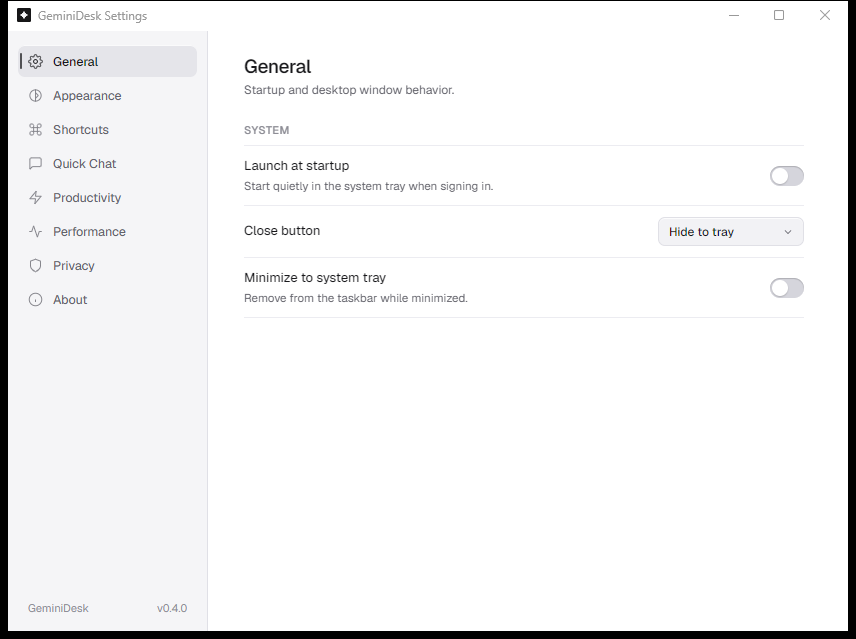
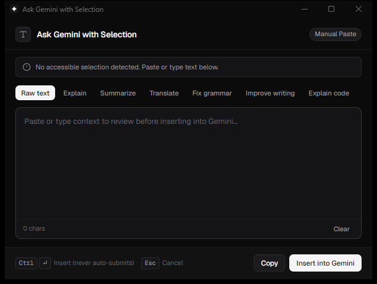
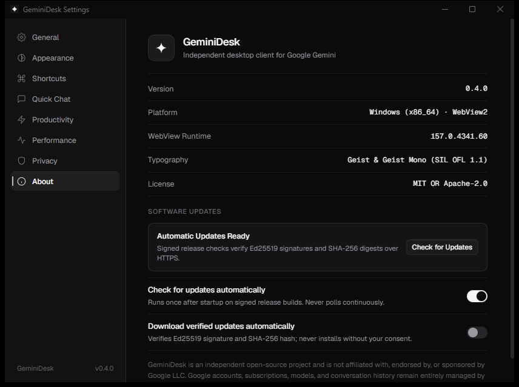

<div align="center">
  
  <h1>GeminiDesk</h1>
  <p>A lightweight native Rust desktop client for Google Gemini.</p>
  <p>
    Built directly on platform WebViews (WebView2, WebKitGTK 4.1, WKWebView) with a single shared renderer, native desktop integration, and zero Electron or bundled Chromium runtime.
  </p>
</div>

---

## Overview

GeminiDesk wraps the official [Google Gemini](https://gemini.google.com/app) web application in a native Rust desktop shell (`tao` + `wry`). Main Window, Quick Chat, and Floating Companion share **one live WebView renderer**, preserving active conversations, streaming responses, drafts, and authentication without spawning duplicate browser engines.

- **Native shell, genuine Gemini:** Google manages all authentication, accounts, subscriptions, models, and chat history directly inside the OS WebView.
- **Single-renderer windowing:** Reparents one WebView across Main Window, Quick Chat, and Floating Companion in ~1–2 ms on Linux (WebKitGTK) and ~16–20 ms on Windows (WebView2).
- **Zero background polling:** Clipboard, selection, and screen capture run strictly on explicit user action; live performance telemetry samples only while viewing **Settings → Performance**.
- **Cryptographically signed updates:** Release metadata (`latest.json`) is verified via detached Ed25519 signatures and streaming SHA-256 checks before any installer handoff.

---

## Platform Compatibility

| Platform | Build Status | Runtime Status | Authentication Status | Packaging |
| --- | --- | --- | --- | --- |
| **Windows 11 (x64)** | Verified (GitHub Actions CI) | Previously user-tested on Windows 11 Pro | Previously user-verified (WebView2) | NSIS Setup Installer, Portable ZIP |
| **Linux — CachyOS / Arch (KDE Plasma 6 · Wayland)** | Verified (Local & CI) | Verified on real hardware (`v1.0.0`) | Real user-verified (WebKitGTK 4.1) | Arch `PKGBUILD`, `.AppImage`, `.tar.gz` |
| **Linux — Debian / Ubuntu / Fedora (Wayland & X11)** | Verified (Ubuntu 24.04 CI) | Not yet runtime-tested on real hardware | Not yet runtime-tested | `.deb`, `.rpm`, `.AppImage`, `.tar.gz` |
| **macOS — Apple Silicon (`arm64`)** | Compiled & packaged (`macos-15` CI) | Untested on real hardware | Untested | Unsigned `.dmg` (experimental) |
| **macOS — Intel (`x86_64`)** | Compiled & packaged (`macos-15` CI) | Untested on real hardware | Untested | Unsigned `.dmg` (experimental) |

> macOS `.dmg` artifacts are compiled and verified via `hdiutil verify` in CI, but have **not** been tested on physical Mac hardware and are **not** Apple Developer ID signed or notarized.

---

## Screenshots

All interface surfaces share a monochrome Geist / Geist Mono design system served locally from memory over `geminidesk://` with zero external CDN requests.

| Settings — General (Dark) | Settings — General (Light) |
| --- | --- |
|  |  |

| Clipboard Actions Palette (Dark) | Ask Gemini with Selection (Dark) |
| --- | --- |
|  |  |

| Live Process-Tree Telemetry | Settings — About & Signed Updates |
| --- | --- |
|  |  |

*(Screenshots captured from GeminiDesk's native UI windows without personal accounts or conversation data.)*

---

## Main Features

- **Main Window:** Full resizable Gemini workspace with persisted window geometry, maximized state, dark/light theme synchronization, and native window icons.
- **Account Switching & Navigation Controls:** Native compact header bar (`Back to Gemini`, active flow title, `Cancel` / `Retry`) while signing in, switching accounts, or viewing Google Account settings — preserving your prior Gemini conversation without clearing cookies or reloading unnecessarily.
- **System Tray:** Persistent native tray (`ksni` StatusNotifierItem on Linux, Win32 tray on Windows, NSStatusItem on macOS) with left-click toggle and right-click access to Open Gemini, Quick Chat, Floating Companion, New Chat, Screenshot, Clipboard Actions, Google Account & Sign-In, Settings, and Quit.
- **Native Desktop Notifications:** Optional system notifications (`org.freedesktop.Notifications` with `notify-send` fallback on Linux) for verified updates and errors. Respects OS Do Not Disturb settings and never displays chat messages, prompts, clipboard contents, or account emails.
- **Settings Window:** Lazy-created native settings dialog destroyed on close (`0 MB` idle RAM) covering General, Account, Appearance, Shortcuts, Quick Chat, Productivity, Performance, Privacy, and About.

---

## Quick Chat

Summon Gemini anywhere on the desktop with **`Alt + Space`** (configurable):

- Borderless floating overlay positioned on the monitor containing your cursor.
- Presets for **Compact** (`720 × 540`), **Standard** (`780 × 580`), **Spacious** (`900 × 640`), or custom logical dimensions.
- Placement presets: Top Center, Screen Center, Top Right, or Bottom Right.
- Shares the single live Gemini session — press **`Ctrl + Shift + E`** to expand directly into the Main Window without interrupting streaming responses, or **`Esc`** to dismiss.

---

## Productivity Tools

All OS capture workflows are **opt-in** (disabled by default in **Settings → Productivity**), execute strictly on demand, never poll in the background, and never auto-submit prompts to Gemini:

- **Floating Companion (`Alt + Shift + G`):** Persistent side panel (`490 × 700` default) with Always-on-Top toggle (`Ctrl + Shift + T`), adjustable opacity (`55%–100%`), and screen-edge snapping.
- **Ask Gemini with Selection (`Alt + Shift + A`):** Captures foreground selection on demand (Windows UI Automation with password-field refusal; Linux KDE Klipper / GTK3 Primary Selection / `wl-paste --primary` / `xclip`), opens an editable review sheet with intent presets (*Raw text*, *Explain*, *Summarize*, *Translate*, *Fix grammar*, *Improve writing*, *Explain code*), and inserts into Gemini's composer.
- **Screenshot to Gemini (`Alt + Shift + S`):** Native interactive region capture (Windows multi-monitor GDI overlay; Linux XDG Screenshot Portal with `spectacle` / `grim`+`slurp` fallback; macOS `screencapture -i`) with preview review before attaching to Gemini's composer.
- **Clipboard Actions (`Alt + Shift + C`):** Searchable two-pane command palette with keyboard shortcuts (`Alt + 1..9`), 7 built-in actions, and user-editable prompt templates (`{{text}}` placeholder).
- **Performance Modes:** Configurable *Efficiency*, *Balanced*, and *Performance* resource profiles with on-demand per-role process-tree telemetry in **Settings → Performance**.

---

## Performance and Resource Usage

GeminiDesk separates **Rust Host** memory (the native shell) from **Full Process-Tree** memory (Rust host plus the embedded OS WebView renderer and network/GPU helpers). Because Google's Gemini web application is a full single-page web app, **Full Process-Tree Private Memory** is the honest headline figure — the Rust host itself is only a small fraction of total RAM.

### Linux Measurements — CachyOS (`v1.0.1`, Real Hardware)

- **System:** CachyOS Linux (`Linux 7.3.4-1-cachyos x86_64`), 6 logical cores, AMD Radeon RX 6600 XT (`Mesa 26.3.1`), `1920×1080 @ 239.76 Hz` display, KDE Plasma 6, Wayland
- **Renderer:** `webkit2gtk-4.1` (`2.54.3-1`), `gtk3` (`3.24.52`), `WEBKIT_DMABUF_RENDERER_FORCE_SHM=1` (accelerated compositing + SHM multi-window transport)
- **Executable / Package Size:** `5.33 MB` release binary · `~2.6 MB` Arch `.pkg.tar.zst`
- **Methodology:** Isolated clean XDG profile (`/proc/<pid>/smaps_rollup` `Private_Clean + Private_Dirty` and `Rss`; 6-second settled CPU intervals across all logical cores; live `gemini.google.com/app` `requestAnimationFrame` frame pacing & input-to-paint timing)

#### Live `gemini.google.com/app` Rendering Smoothness (`v1.0.0` → `v1.0.1`)

| Workload (Live `gemini.google.com/app`) | `v1.0.0` (`WEBKIT_DISABLE_DMABUF_RENDERER=1`) | `v1.0.1` (`WEBKIT_DMABUF_RENDERER_FORCE_SHM=1`) | Improvement |
| --- | --- | --- | --- |
| **Typing in prompt** | `19.9 FPS` (`p50: 37 ms`, `p95: 87 ms`, `100%` > 16.7 ms) | **`87.0 FPS`** (`p50: 10 ms`, `p95: 18 ms`, `5.5%` > 16.7 ms) | **4.4× FPS** |
| **Input-to-paint latency** | `36 ms` P50 · `87 ms` P95 | **`15 ms` P50 · `25 ms` P95** | **2.4×–3.5× lower** |
| **Scrolling** | `16.7 FPS` (`p50: 74 ms`, `p95: 77 ms`, `100%` > 16.7 ms) | **`110.6 FPS`** (`p50: 8 ms`, `p95: 10 ms`, `1.4%` > 16.7 ms) | **6.6× FPS** |
| **Sidebar transitions** | `13.3 FPS` (`p50: 76 ms`, `p95: 77 ms`, `100%` > 16.7 ms) | **`105.2 FPS`** (`p50: 9 ms`, `p95: 13 ms`, `0.9%` > 16.7 ms) | **7.9× FPS** |

#### Process-Tree Memory & Idle CPU (`v1.0.1`, Warm Profile)

| State (`v1.0.1`, Warm Profile) | Processes | Rust Host Private | Full Tree Private | Full Tree RSS | Settled CPU (Host / Total) |
| --- | --- | --- | --- | --- | --- |
| **Main Window (Visible, Balanced)** | 3 core* | 50.7 MB | 796.3 MB | 1,105.7 MB | 5.69% / 21.28%** |
| **Quick Chat (Visible, Balanced)** | 3 core* | 47.5 MB | 810.3 MB | 1,111.5 MB | 4.63% / 23.71%** |
| **Background Tray — Balanced** | 3 | 46.8 MB | 816.6 MB | 1,095.9 MB | **0.00% / 0.44%** |
| **Background Tray — Efficiency** | 3 | 49.1 MB | 836.1 MB | 1,119.3 MB | **0.03% / 0.06%** |
| **Background Tray — Performance** | 3 | 46.8 MB | 812.3 MB | 1,092.0 MB | **0.03% / 0.67%** |
| **Settings Open (Temporary 2nd Renderer)** | 4 | 50.7 MB | 1,259.3 MB | 1,761.4 MB | — |

- **Startup & Reparenting (`v1.0.1`, CachyOS):** Native windows ready `~161 ms` · WebKitGTK init `~231 ms` · First navigation `~446 ms` · Single-WebView reparent (Main ↔ Quick Chat ↔ Companion) **`1–2 ms`** with zero black/blank surfaces.
- **Honest Resource Trade-off Note:** Restoring GPU-accelerated WebKitGTK compositing adds ~270 MB of Mesa/Skia GPU shader & surface memory inside `WebKitWebProcess` compared to `v1.0.0`'s software fallback (`~514 MB` → `~796 MB`, comparable to WebView2's historical `645–785 MB` on Windows 11), while improving live Gemini UI frame rates by **4.4×–7.9×** and keeping background tray CPU near `0%`. Users on very low-RAM systems or troubleshooting GPU drivers can still force software rendering with `GEMINIDESK_SOFTWARE_RENDER=1`.
- *\*During the first ~15s after startup, GTK's `gdk-pixbuf` glycin icon loader briefly spawns transient helper processes before exiting to the steady-state 3-process tree (`Rust Host` + `WebKitWebProcess` + `WebKitNetworkProcess`).*
- *\*\*Measured on the signed-out Gemini landing page while its continuous hero animation is actively rendering at ~100 FPS; hidden tray CPU drops to `0.06%–0.67%`.*

### Historical Windows 11 Measurements (Reference Only)

> **Important:** The figures below are **historical observations** collected during earlier development on Windows 11 Pro (`x64`, build 26300, Microsoft Edge WebView2 `157.0.4341.60`). They are **not** fresh `v1.0.0` controlled benchmarks and should not be compared 1:1 against Linux WebKitGTK measurements due to differences in Chromium multi-process architecture, memory accounting (`PrivateUsage` / `WorkingSetSize` vs Linux `smaps_rollup`), and workload state.

| Historical Windows 11 Snapshot | Processes | Rust Host Private / WS | Full Tree Private RAM | Snapshot CPU |
| --- | --- | --- | --- | --- |
| **Sample A (Active Session Snapshot)** | 9 (8 WebView2) | 4.2 MB / 25.2 MB | 785.2 MB | 11.44% |
| **Sample B (Active Session Snapshot)** | 9 (8 WebView2) | 5.6 MB / 31.5 MB | 644.5 MB | 9.95% |

- Earlier Windows prototype warm-start observation loaded `gemini.google.com/app` in approximately `1.1 s`.
- On Windows, **Efficiency** mode also uses WebView2's native `ICoreWebView2_3::TrySuspend` (strictly guarded against active streaming, audio playback, and navigation) to release renderer working set while minimized to the tray.

---

## Installation

Download prebuilt packages from the [GitHub Releases](https://github.com/existye4t/gemini-desk/releases) page.

### Windows 11 (x64)

- **Recommended:** Download and run `GeminiDesk-1.0.2-Windows-x64-Setup.exe` (per-user install to `%LOCALAPPDATA%\Programs\GeminiDesk`, no administrator elevation required; upgrades preserve settings and Google sign-in).
- **Portable:** Extract `GeminiDesk-1.0.2-Windows-x64-Portable.zip` and run `gemini-desk.exe`.

### Linux — Arch Linux / CachyOS (Fish shell)

Build and install natively using the repository `PKGBUILD`:

```fish
sudo pacman -S --needed base-devel git rust pkgconf webkit2gtk-4.1 gtk3 openssl xdg-desktop-portal xdg-desktop-portal-kde
git clone https://github.com/existye4t/gemini-desk.git
cd gemini-desk/packaging/linux
makepkg -si
```

### Linux — Debian / Ubuntu

```bash
sudo apt install ./GeminiDesk-1.0.2-Linux-x86_64.deb
```

### Linux — Fedora / RPM-based

```bash
sudo dnf install ./GeminiDesk-1.0.2-Linux-x86_64.rpm
```

### Linux — AppImage & Portable Tarball

```bash
chmod +x GeminiDesk-1.0.2-Linux-x86_64.AppImage
./GeminiDesk-1.0.2-Linux-x86_64.AppImage
```

### macOS (Apple Silicon & Intel — Experimental / Unsigned)

Download `GeminiDesk-1.0.2-macOS-AppleSilicon.dmg` (M1–M4) or `GeminiDesk-1.0.2-macOS-Intel.dmg` (x86_64) and drag **GeminiDesk** to `/Applications`.

> Because macOS releases are currently **unsigned and unnotarized**, Gatekeeper will display a warning on first launch and macOS runtime behavior has not yet been verified on physical Mac hardware.

---

## Platform-Specific Requirements

- **Windows 11:** Microsoft Edge WebView2 Runtime (pre-installed on Windows 11; the NSIS installer detects missing WebView2 cleanly).
- **Linux:** `webkit2gtk-4.1`, `gtk3`, `openssl`, and `xdg-desktop-portal`.
  - Recommended on KDE Plasma 6 Wayland: `xdg-desktop-portal-kde`, `spectacle`, `wl-clipboard`.
  - Recommended on GNOME: `xdg-desktop-portal-gtk`, `wl-clipboard`.
  - Recommended on X11: `xclip`.
- **macOS:** macOS 13.0 (Ventura) or newer with system `WKWebView`.

---

## Global Shortcuts

| Action | Default Shortcut | Opt-In | CLI Wake Flag |
| --- | --- | --- | --- |
| **Quick Chat** | `Alt + Space` | Always enabled | `gemini-desk --quick-chat` |
| **Main Window** | `Alt + Shift + Space` | Always enabled | `gemini-desk` |
| **Floating Companion** | `Alt + Shift + G` | Always enabled | `gemini-desk --companion` |
| **Ask Gemini with Selection** | `Alt + Shift + A` | Opt-in | `gemini-desk --ask-selection` |
| **Screenshot to Gemini** | `Alt + Shift + S` | Opt-in | `gemini-desk --screenshot` |
| **Clipboard Actions** | `Alt + Shift + C` | Opt-in | `gemini-desk --clipboard-actions` |

Additional window shortcuts:
- `Esc` — Dismiss Quick Chat, or safely cancel Account Chooser when no input/dialog is focused.
- `Alt + Left` — Navigate back cleanly (returns to Gemini when at the start of an account switch).
- `Ctrl + Shift + E` — Expand Quick Chat or Floating Companion into the Main Window.
- `Ctrl + Shift + T` — Toggle Floating Companion Always-on-Top.
- `Ctrl + ,` (`Cmd + ,` on macOS) — Open Settings.

**Linux Wayland note:** On KDE Plasma 6 and other compositors supporting `org.freedesktop.portal.GlobalShortcuts`, GeminiDesk registers shortcuts natively through the XDG portal (and handles permission denial gracefully). On compositors without portal support (such as GNOME Wayland), bind desktop custom shortcuts directly to the CLI flags above — GeminiDesk wakes the running instance over `$XDG_RUNTIME_DIR/io.geminidesk.GeminiDesk.sock`.

---

## Authentication and Account Privacy

- **Direct official Google sign-in:** Authentication runs directly on `accounts.google.com` inside the native OS WebView (`WebView2`, `WebKitGTK 4.1`, or `WKWebView`). Sessions persist locally across restarts in your isolated per-user WebView profile (`0700` owner-only directory permissions on Unix).
- **Why external-browser OAuth is not used:** Consumer `https://gemini.google.com/app` authenticates via first-party Google web cookies, not OAuth 2.0 API access tokens. Google provides no public, supported API to transfer an external-browser login into embedded WebView cookies. Rather than fabricating a broken OAuth screen, scraping external browser profiles, or using undocumented Google endpoints, GeminiDesk uses Google's official in-WebView sign-in and account chooser and provides an honest **Open Browser** fallback in **Settings → Account**.
- **Safe Account Switching:** Use **Settings → Account** (`gemini-desk --account`) or Tray → **Google Account & Sign-In…** to sign in, switch accounts, add an account, or sign out. A compact native **Back to Gemini / Cancel** bar appears automatically during account flows; canceling never clears cookies or storage and re-verifies the actual active Google session upon returning.
- **Zero credential handling:** GeminiDesk never reads Google passwords, never extracts cookies from Zen, Firefox, Chrome, Edge, or Safari, never spoofs User-Agents, and redacts query strings/fragments from all navigation logs.

---

## Automatic Updates

GeminiDesk includes an optional, fail-closed automatic updater (**Settings → About**):

1. Fetches `latest.json` and its detached Ed25519 signature `latest.json.sig` over HTTPS (`ureq` with OS native TLS).
2. Verifies the Ed25519 signature against GeminiDesk's compile-time pinned public key (`ce042ef3aa7286c10ae6fdd6a886cfee2bc7ec09cd24d1862ca878adc5b1b637`) before parsing JSON.
3. Enforces SemVer anti-downgrade rules (`remote > current` and `current >= min_supported_version`) and trusted GitHub Releases HTTPS hosts.
4. Streams downloads into `.part` staging files with incremental SHA-256 verification and pre-install on-disk TOCTOU re-verification.
5. Never installs silently without explicit user confirmation and always preserves your settings and Google sign-in profile.

Automatic startup checks and automatic downloads can each be toggled independently in **Settings → About**.

---

## Building from Source

### Linux — CachyOS / Arch (Fish shell)

```fish
sudo pacman -S --needed base-devel git rust pkgconf webkit2gtk-4.1 gtk3 openssl xdg-desktop-portal xdg-desktop-portal-kde
git clone https://github.com/existye4t/gemini-desk.git
cd gemini-desk
cargo build --release --locked
./target/release/gemini-desk
```

### Linux — Ubuntu 24.04 / Debian

```bash
sudo apt-get update
sudo apt-get install -y libwebkit2gtk-4.1-dev libgtk-3-dev libssl-dev pkg-config libxdo-dev xdg-desktop-portal
cargo build --release --locked
./target/release/gemini-desk
```

### Windows 11 (PowerShell)

```powershell
cargo build --release --locked
.\target\release\gemini-desk.exe
```

### macOS

```bash
cargo build --release --locked
./target/release/gemini-desk
```

---

## Development and Testing

Run the full local quality gate before submitting changes:

```fish
cargo fmt --check
cargo clippy --all-targets -- -D warnings
cargo test --locked
cargo build --release --locked
```

Linux metadata validation:

```fish
desktop-file-validate packaging/linux/io.geminidesk.GeminiDesk.desktop
appstreamcli validate --no-net packaging/linux/io.geminidesk.GeminiDesk.metainfo.xml
```

---

## Known Limitations

- **WebView Memory Baseline:** While the Rust host is minimal, Google's live Gemini web application requires ~415–465 MB inside `WebKitWebProcess` on Linux (and ~645–785 MB across Chromium/WebView2 processes in historical Windows snapshots).
- **Wayland Global Window Positioning:** Wayland compositors intentionally prevent clients from setting arbitrary global `(x, y)` coordinates; KWin/Mutter control final placement for floating windows.
- **Linux WebKitGTK Multi-Toplevel Reparenting:** GeminiDesk sets `WEBKIT_DISABLE_DMABUF_RENDERER=1` on Linux (unless explicitly overridden in the environment) to prevent blank DMABuf surfaces when reparenting the shared `WebKitWebView` across Main Window, Quick Chat, and Floating Companion on Wayland.
- **macOS Status:** macOS builds are compiled and packaged in CI, but remain unsigned, unnotarized, and untested on physical Mac hardware.
- **External Browser Session Transfer:** Google does not support transferring external browser logins (Zen, Firefox, Chrome, Safari) into embedded WebView cookies for `gemini.google.com/app`.

---

## Contributing

Contributions are welcome. Please read [CONTRIBUTING.md](CONTRIBUTING.md) for architecture principles, coding guidelines, and testing expectations.

---

## Security

Security boundaries, key rotation procedures, and responsible vulnerability disclosure instructions are documented in [SECURITY.md](SECURITY.md). Please report security vulnerabilities privately via GitHub Security Advisories rather than public issues.

---

## License

Dual-licensed under either of:

- **MIT License** ([LICENSE-MIT](LICENSE-MIT))
- **Apache License, Version 2.0** ([LICENSE-APACHE](LICENSE-APACHE))

Bundled **Geist** and **Geist Mono** fonts are licensed under the SIL Open Font License 1.1 ([assets/fonts/OFL-Geist.txt](assets/fonts/OFL-Geist.txt)). See [THIRD_PARTY_LICENSES.md](THIRD_PARTY_LICENSES.md) for full attribution.

---

## Disclaimer

GeminiDesk is an independent open-source project and is **not** developed by, affiliated with, endorsed by, or sponsored by Google LLC. "Google" and "Gemini" are trademarks of Google LLC. All Google accounts, subscriptions, AI models, and conversations remain governed by Google's terms and privacy policies.
