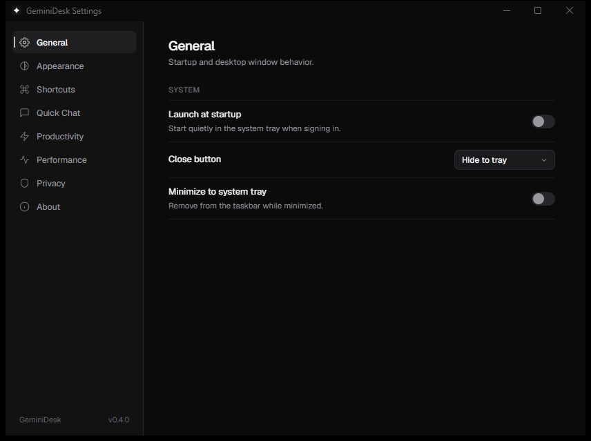
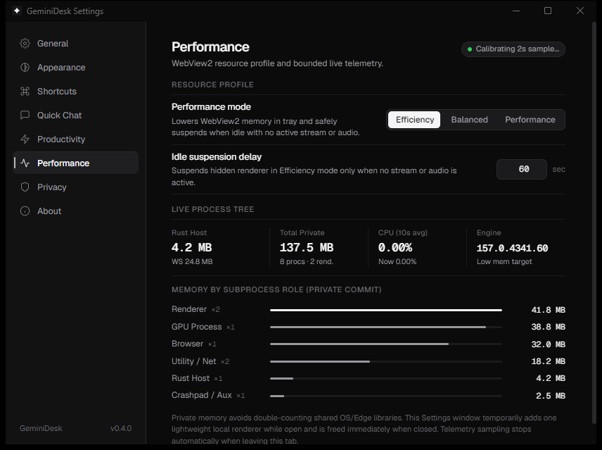
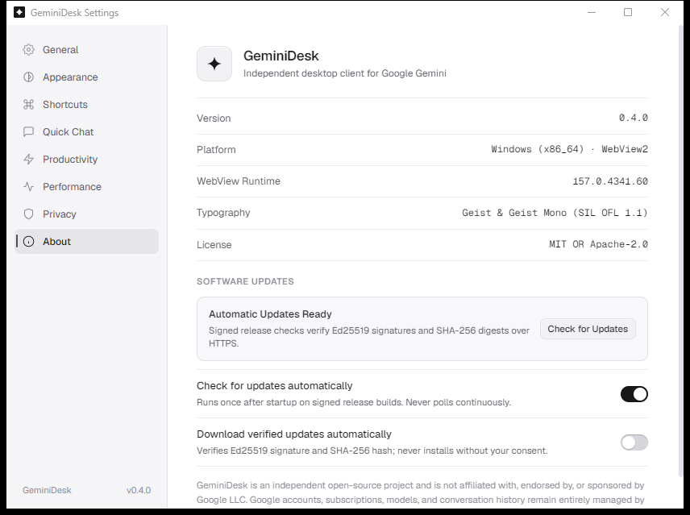
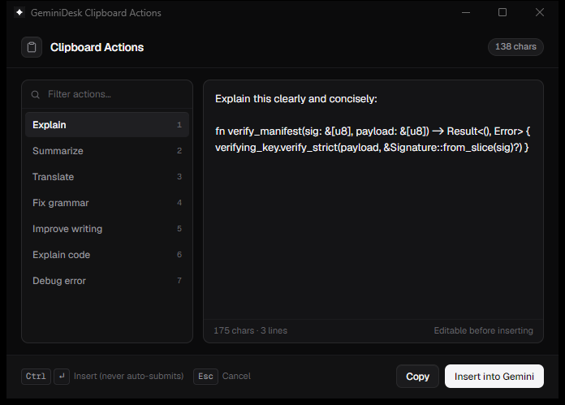

# GeminiDesk

An unofficial, ultra-lightweight, high-performance desktop client for Google Gemini written in Rust.

> **Unofficial Client Disclaimer:** GeminiDesk is an independent open-source desktop shell for [Google Gemini](https://gemini.google.com). It is **not** affiliated with, endorsed by, or sponsored by Google LLC. All Google accounts, authentication, subscriptions, AI models, and conversation history remain entirely managed by Google.

---

## Philosophy

**"Premium simplicity. Native speed. Genuine Gemini."**

GeminiDesk wraps Google's official Gemini web application inside a thin native Rust desktop shell without Electron, Node.js, or bundled Chromium runtimes:

- **Core Stack:** Rust (`tao` + `wry` + `tray-icon` + `muda` + `global-hotkey` + native OS APIs)
- **Native OS WebViews:** Microsoft Edge **WebView2** (Windows), **WebKitGTK 4.1** (Linux), **WKWebView** (macOS)
- **Single-WebView Reparenting:** Main Window, Smart Mini Chat (Quick Chat), and Floating Companion all share **one single live WebView renderer**, preserving active conversations, streaming responses, and Google sign-in across ~15–21 ms transitions with zero duplicate browser processes.
- **Refined Local Design System:** Settings and all productivity dialogs share a quiet monochrome design system (`src/ui/design-system.css`) with locally bundled **Geist** & **Geist Mono** variable fonts (`SIL OFL 1.1`, full Latin + Turkish glyph coverage, zero external CDN calls) served over an isolated `geminidesk://` local protocol.
- **Cryptographically Authenticated Updates:** Release metadata (`latest.json`) is verified via a detached **Ed25519** signature (`latest.json.sig`) and **SHA-256** artifact verification over HTTPS before any download or installer handoff.

---

## Platform Support Matrix

GeminiDesk only labels a platform **Supported** after real-hardware verification of installation, rendering, Google sign-in, session persistence, and desktop integrations. Compilation alone does not prove authentication or runtime compatibility.

| Platform | Target / WebView | Status | Packages | Verification Notes |
| --- | --- | --- | --- | --- |
| **Windows 11 (x64)** | `x86_64-pc-windows-msvc` · **WebView2** | **Verified (Supported)** | NSIS Per-User Installer (`1.19 MB`), Portable ZIP (`1.37 MB`) | Real-hardware verified: Google auth, session persistence, Quick Chat, Companion, tray, shortcuts, productivity, installer/upgrade/uninstall, and controlled benchmarks. |
| **Linux — CachyOS / Arch (KDE Plasma · Wayland)** | `x86_64-unknown-linux-gnu` · **WebKitGTK 4.1** | **Beta** *(Desktop Verified · Interactive Auth Test Ready)* | Arch `PKGBUILD` (`2.49 MB` `.pkg.tar.zst`), `.deb`, `.rpm`, lean `AppImage` | Real-hardware verified on CachyOS (`Linux 7.3.4-1-cachyos`, KDE Plasma 6 Wayland, WebKitGTK `2.54.3`): single-WebView reparenting (`0–2 ms`), `780×580` Quick Chat, Companion, XDG Portals (`GlobalShortcuts`, interactive `Screenshot`, `Settings`), `ksni` tray, native KDE Klipper D-Bus + GTK3 clipboard, `/proc` telemetry, Unix-socket CLI wake, and `makepkg` package build. Interactive Google sign-in + restart persistence ready for user verification. |
| **Linux — X11 / GNOME** | `x86_64-unknown-linux-gnu` · **WebKitGTK 4.1** | **Experimental** *(Real-Device Testing Pending)* | `.deb`, `.rpm`, lean `AppImage` | Implemented: X11 `global-hotkey`, GTK3 clipboard + `xclip`/`xsel`, XDG `Screenshot` & `Settings` portals. Real-device verification pending. |
| **macOS — Apple Silicon & Intel** | `aarch64` / `x86_64-apple-darwin` · **WKWebView** | **Experimental** *(Real-Device Testing Pending)* | `.app` bundle, `.dmg` *(unsigned until Apple Developer secrets configured)* | Implemented: `WKWebView` reparenting, native App Menu Bar, Dock reopen, LaunchAgent startup, `NSPasteboard`, interactive `screencapture -i`, `ps` telemetry. Real-device WKWebView Google auth & Gatekeeper notarization pending. |

---

## Features (`v0.4.0`)

### Desktop Shell & Settings
- **Two-Column Settings (`Ctrl + ,` / `Cmd + ,` or Tray → Settings):** 9 sections (*General*, *Account*, *Appearance*, *Shortcuts*, *Quick Chat*, *Productivity*, *Performance*, *Privacy*, *About*) with monochrome Dark (`#0B0B0C`) and independently calibrated Light (`#FFFFFF`) themes, bundled Geist + Geist Mono typography, custom popover dropdowns, sliding segmented controls, click-to-record `<kbd>` shortcut recorders, inline confirmation dialogs, `prefers-reduced-motion` support, and zero idle RAM when closed.
- **Google Account & Sign-In (`Settings → Account`, Tray → *Google Account & Sign-In...*, or `--account` / `--sign-in`):** Direct Google Account Chooser, Switch/Add Account, Sign Out, live session status, persistent WebView profile indicator, and an explicitly labeled *Open Gemini in Default Browser* fallback (without fake OAuth handoffs or browser cookie extraction).
- **Persistent System Tray:** Event-driven (`0.000%` Rust idle CPU) native tray on Windows (Win32), Linux (`ksni` StatusNotifierItem over D-Bus — native KDE Plasma support with zero `libappindicator3` dependency), and macOS (Menu Bar + Status Item).
- **Single-Instance Activation:** Secondary invocations with CLI flags (`--quick-chat`, `--companion`, `--settings`, `--clipboard-actions`, `--ask-selection`, `--screenshot`) wake the running instance instantaneously via Win32 messages (Windows) or Unix domain sockets (Linux/macOS).

### Six Native Productivity Features
1. **Ask Gemini with Selection** (`Alt + Shift + A`, opt-in):
   - Windows: reads selected text via **Windows UI Automation (`IUIAutomation`)** (explicitly refusing `CurrentIsPassword` fields), with optional non-destructive clipboard snapshot/restore fallback.
   - Linux: reads Wayland/X11 Primary Selection (`wl-paste --primary` / `xclip`) strictly on invocation.
   - Opens an editable writing sheet with a single-row quick-intent rail (*Raw text*, *Explain*, *Summarize*, *Translate*, *Fix grammar*, *Improve writing*, *Explain code*) and `Ctrl + Enter` insertion (never auto-submits).
2. **Screenshot to Gemini** (`Alt + Shift + S`, opt-in, or Tray → *Capture Screenshot*):
   - Windows: native Win32 multi-monitor, mixed-DPI virtual-screen region selector with pure in-memory PNG encoding.
   - Linux: **XDG Screenshot Portal** (`org.freedesktop.portal.Screenshot`, `interactive = true`) for explicit user-approved KDE Plasma / GNOME region capture, with `spectacle` / `grim`+`slurp` fallback.
   - macOS: native interactive `/usr/sbin/screencapture -i -x -t png` honoring macOS Screen Recording permissions.
   - Opens an image-first matte dotted gallery stage with `W × H · PNG · N KB` badge, optional instruction bar, *Attach to Gemini*, *Copy Image*, and *Retake*.
3. **Smart Mini Chat (Quick Chat)** (`Alt + Space`):
   - Borderless always-on-top Spotlight-style overlay on the active cursor monitor with size presets (`Compact` / `Standard` / `Spacious` / custom W×H) and placement options. `Esc` hides, `Ctrl + Shift + E` expands to the Full Window.
4. **Floating Companion** (`Alt + Shift + G`):
   - Resizable persistent side window (`490 × 700` default) sharing the single live WebView renderer, with **Always on Top** (`Ctrl + Shift + T`), window opacity (`55%–100%`), edge snapping, and persisted geometry.
5. **Clipboard Actions** (`Alt + Shift + C`, opt-in):
   - Raycast-style searchable two-pane command palette with `↑`/`↓` navigation, `Alt+1..9` instant selection, 7 built-in actions, and a custom prompt template editor in Settings → Productivity. Reads clipboard strictly on invocation; never stores history or logs contents.
6. **Performance Mode & Live Per-Role Telemetry** (Settings → Performance):
   - **Efficiency**, **Balanced**, and **Performance** resource profiles with taskbar-minimized throttling (`SW_MINIMIZE`) and safe Efficiency `TrySuspend` guards (checks in-flight navigation, `IsDocumentPlayingAudio`, and active Gemini streaming before suspending).
   - On-demand per-subprocess memory breakdown (*Renderer*, *GPU Process*, *Browser*, *Utility / Net*, *Rust Host*) and rolling 10s averaged + instantaneous 2s CPU % — stops immediately when leaving the tab.

### Secure Automatic Updates (`Settings → About`)
- Verifies detached **Ed25519** signatures (`latest.json.sig`) against a compile-time pinned public key (`ce042ef3aa7286c10ae6fdd6a886cfee2bc7ec09cd24d1862ca878adc5b1b637`) before parsing update metadata.
- Enforces HTTPS-only transfers (OS native TLS store + trusted GitHub Releases host allowlist), strict SemVer anti-downgrade protection, streaming `.part` downloads with exact byte-size + **SHA-256** verification, pre-install TOCTOU re-verification, and interrupted-download cleanup.
- Never installs major updates without user consent; unsigned local builds fail closed cleanly.

---

## Visual Overview (`v0.4.0`)

| Settings — General (Dark) | Settings — Performance Telemetry (Dark) |
| --- | --- |
|  |  |

| Settings — About & Signed Updater (Dark) | Settings — About & Signed Updater (Light) |
| --- | --- |
|  |  |

| Clipboard Actions Command Palette (Dark) | Ask Gemini with Selection (Dark) |
| --- | --- |
|  |  |

---

## Installation

### Windows 11 (x64)
1. **Recommended — Per-User Installer (no admin prompt required):**
   Download and run `GeminiDesk-0.4.0-Windows-x64-Setup.exe` from [GitHub Releases](https://github.com/existye4t/gemini-desk/releases).
   - Installs to `%LOCALAPPDATA%\Programs\GeminiDesk`, creates Start Menu & optional Desktop shortcuts, detects Microsoft Edge WebView2 Runtime, supports silent `/S /AUTORESTART` upgrades, and preserves your Google sign-in & settings across all upgrades.
   - Uninstalling asks explicitly whether to remove saved settings/session data (defaults to **No / Keep data**).
2. **Portable ZIP:**
   Extract `GeminiDesk-0.4.0-Windows-x64-Portable.zip` and run `gemini-desk.exe`.
   - **Profile Note:** Both the Portable ZIP and the Per-User Installer store configuration in `%APPDATA%\geminidesk\GeminiDesk\config\config.toml` and WebView2 session data in `%LOCALAPPDATA%\geminidesk\GeminiDesk\data\webview`, so switching between portable and installed builds preserves your Google sign-in and preferences without duplicating browser data.

### Linux — CachyOS / Arch Linux (KDE Plasma · Wayland · Fish Shell)
Install runtime and build dependencies:
```fish
sudo pacman -S --needed webkit2gtk-4.1 gtk3 openssl xdg-desktop-portal xdg-desktop-portal-kde wl-clipboard rust pkgconf
```

**Option A — Clone & build via Arch `PKGBUILD`:**
```fish
git clone https://github.com/existye4t/gemini-desk.git
cd gemini-desk/packaging/linux
makepkg -si
```

**Option B — Download prebuilt CI / Draft Release artifacts via GitHub CLI (`gh`):**
```fish
mkdir -p /tmp/geminidesk-linux; and cd /tmp/geminidesk-linux
gh run download --repo existye4t/gemini-desk -n geminidesk-linux-x86_64
chmod +x GeminiDesk-0.4.0-Linux-x86_64.AppImage
./GeminiDesk-0.4.0-Linux-x86_64.AppImage
```

**Option C — Build & run directly with Cargo:**
```fish
cargo build --release --locked
./target/release/gemini-desk
```

**Wayland & KDE Plasma Notes:**
- Verify your portal environment variables in Fish:
  ```fish
  echo $XDG_CURRENT_DESKTOP  # Expected: KDE
  echo $XDG_SESSION_TYPE     # Expected: wayland
  ```
- On KDE Plasma 6 Wayland, GeminiDesk registers shortcuts through `org.freedesktop.portal.GlobalShortcuts` (manageable in *System Settings → Keyboard → Shortcuts*). On compositors without the `GlobalShortcuts` portal (such as GNOME Wayland), bind desktop custom shortcuts directly to GeminiDesk's instant Unix-socket CLI commands:
  - `gemini-desk --quick-chat`
  - `gemini-desk --companion`
  - `gemini-desk --clipboard-actions`
  - `gemini-desk --ask-selection`
  - `gemini-desk --screenshot`
- If you encounter WebKitGTK GPU/DMABUF rendering glitches on NVIDIA + Wayland, launch with:
  ```fish
  set -x GEMINIDESK_SOFTWARE_RENDER 1
  set -x WEBKIT_DISABLE_DMABUF_RENDERER 1
  gemini-desk
  ```

### Linux — Debian / Ubuntu / Fedora / AppImage
- **Debian / Ubuntu (`.deb`):** `sudo apt install ./GeminiDesk-0.4.0-Linux-x86_64.deb` (requires `libwebkit2gtk-4.1-0`, `libgtk-3-0`, `xdg-desktop-portal`).
- **Fedora (`.rpm`):** `sudo dnf install ./GeminiDesk-0.4.0-Linux-x86_64.rpm` (requires `webkit2gtk4.1`, `gtk3`, `xdg-desktop-portal`).
- **Lean AppImage:** `chmod +x GeminiDesk-0.4.0-Linux-x86_64.AppImage && ./GeminiDesk-0.4.0-Linux-x86_64.AppImage` — intentionally keeps host `WebKitGTK 4.1` and `GTK3` external rather than bundling a 200+ MB runtime.
- **Portable Tarball:** `tar -xzf GeminiDesk-0.4.0-Linux-x86_64.tar.gz && ./gemini-desk`

### macOS (Apple Silicon & Intel — Experimental)
Download `GeminiDesk-0.4.0-macOS-AppleSilicon.dmg` or `GeminiDesk-0.4.0-macOS-Intel.dmg`, or build locally:
```bash
cargo build --release --locked
./packaging/macos/build-bundle.sh 0.4.0 aarch64
```
> **macOS Signing & Gatekeeper Notice:** Production macOS distribution requires Apple Developer ID signing (`MACOS_SIGNING_IDENTITY`) and Apple notarization (`APPLE_ID`, `APPLE_TEAM_ID`, `APPLE_APP_PASSWORD`) configured in CI secrets. Unsigned local/CI `.dmg` builds are development previews only — GeminiDesk never instructs users to disable Gatekeeper.

---

## Keyboard Shortcuts

| Action | Default Shortcut | Notes |
| --- | --- | --- |
| Toggle Quick Chat | `Alt + Space` | Always active; customizable in Settings → Shortcuts |
| Open Full Window | `Alt + Shift + Space` | Always active |
| Toggle Floating Companion | `Alt + Shift + G` | Always active |
| Ask Gemini with Selection | `Alt + Shift + A` | Opt-in (Settings → Productivity) |
| Screenshot to Gemini | `Alt + Shift + S` | Opt-in (Settings → Productivity) |
| Clipboard Actions | `Alt + Shift + C` | Opt-in (Settings → Productivity) |
| Settings | `Ctrl + ,` / `Cmd + ,` | In-app shortcut |
| Expand Quick Chat / Companion | `Ctrl + Shift + E` | Expands into Main Window |
| Toggle Companion Always-on-Top | `Ctrl + Shift + T` | While Companion is focused |
| Hide Quick Chat | `Esc` | Preserves conversation |

---

## CLI Flags

- `--minimized` / `--tray`: Start quietly in the system tray.
- `--quick-chat`: Launch or wake directly into Quick Chat.
- `--companion`: Launch or wake directly into Floating Companion.
- `--settings` / `--settings=<tab>`: Open Settings (e.g., `--settings=account`, `--settings=about`, `--settings=performance`).
- `--account`: Open Settings directly on the Google Account & Sign-In tab.
- `--sign-in`: Open the Main Window directly to Google's official Account Chooser (`accounts.google.com/AccountChooser`).
- `--clipboard-actions`: Open Clipboard Actions command palette.
- `--ask-selection`: Open Ask Gemini with Selection sheet.
- `--screenshot`: Trigger interactive Screenshot to Gemini capture.
- `--preview-theme=<dark|light|system>`: Preview theme without modifying `config.toml`.

---

## Measured Windows 11 Performance (`v0.4.0` vs `v0.3.1`, Release Build)

Measured on Windows 11 Pro (Build 26300, x64, 6 logical cores, WebView2 Runtime `157.0.4341.60`) against a live authenticated Google Gemini Pro session (`15s` settle + sustained `30s` continuous sampling across the full process tree, normalized by 6 logical cores):

| Scenario / Metric | `v0.3.1` (60s settled) | `v0.4.0` Final (30s settled) | Notes |
| --- | --- | --- | --- |
| Release executable size | `2.13 MB` | **`2.68 MB` (`2,814,976 B`)** | Adds embedded multi-res `.ico`, `VERSIONINFO`, Ed25519 + SHA-256 + HTTPS updater |
| Windows NSIS Installer / Portable ZIP | — | **`1.19 MB` / `1.37 MB`** | LZMA-compressed per-user installer (`1,251,227 B`) & portable ZIP (`1,437,003 B`) |
| Native windows ready (Run 1 / Warm) | `28 ms` / `39 ms` | **`42 ms` / `49 ms`** | — |
| WebView2 initialized (Run 1 / Warm) | `360 ms` / `406 ms` | **`342 ms` / `365 ms`** | — |
| First visible Gemini title (Run 1 / Warm) | `2,050 ms` / `2,434 ms` | **`1,997 ms` / `1,960 ms`** | Includes network round-trip |
| Quick Chat / Companion reparent latency | `17 ms` | **`16 ms` / `20 ms`** | Single shared live renderer |
| Rust host Private RAM / Idle CPU | `3.63–3.73 MB` / `0.000%` | **`4.73–5.31 MB` / `0.000%–0.035%`** | `0.000s` Rust CPU time in Quick Chat, Companion, Settings & Efficiency tray |
| Visible Gemini Home (settled) | `714.4 MB` Priv · `932.5 MB` WS · `7.22%` CPU | **`719.27 MB` Priv · `990.18 MB` WS · `6.684%` CPU** | 8 processes (1 renderer: `470.78 MB` Priv) |
| Quick Chat / Companion Idle (12s) | — | **`722.21 MB` / `727.28 MB` Priv · `5.664%` / `5.816%` CPU** | Zero extra renderer processes |
| Taskbar-Minimized (`SW_MINIMIZE`, 30s) | `436.9 MB` Priv · `93.5 MB` WS · `0.078%` CPU | Same engine path | **−89% WS, −98% CPU** vs visible |
| Background Tray — **Balanced** (30s) | `284.2 MB` Priv · `241.6 MB` WS · `0.417%` CPU | **`291.36 MB` Priv · `224.24 MB` WS · `0.321%` CPU** | Instant wake |
| Background Tray — **Efficiency Safe-Suspended** (30s) | `282.9 MB` Priv · `64.2 MB` WS · `0.061%` CPU | **`285.34 MB` Priv · `78.02 MB` WS · `0.052%` CPU** | Renderer WS: **`0.92 MB`**; Rust CPU: **`0.000%`**; Quick Chat wake **`21 ms`** |

---

## Measured CachyOS Linux Performance (`v0.4.0`, Release Build)

Measured on CachyOS Linux (`Linux 7.3.4-1-cachyos`, `x86_64`, 6 logical cores, AMD Radeon RX 6600, KDE Plasma 6 Wayland, `webkit2gtk-4.1` `2.54.3-1`, `gtk3` `3.24.52`) across the full `/proc` process tree (`smaps_rollup` `Private_Clean + Private_Dirty` and `Rss`):

| Scenario / Metric | `v0.4.0` CachyOS Wayland | Notes |
| --- | --- | --- |
| Release executable size | **`5.21 MB` (`5,468,008 B`)** | Links system `libwebkit2gtk-4.1.so`, `libgtk-3.so`, and `libssl.so` |
| Native Arch/CachyOS Package (`makepkg`) | **`2.49 MB` (`2,612,210 B`)** | `geminidesk-0.4.0-1-x86_64.pkg.tar.zst` (binary, `.desktop`, AppStream XML, hicolor SVG/PNG icons, licenses) |
| Native windows ready | **`134–149 ms`** | GTK3 Wayland + XDG Settings Portal dark-mode query |
| WebKitGTK initialized | **`186–208 ms`** | Persistent `WebsiteDataManager` (`~/.local/share/geminidesk/webview`) |
| First navigation dispatched | **`249–267 ms`** | `https://gemini.google.com/app` |
| First visible Gemini title | **`723–815 ms`** | Includes network round-trip |
| Quick Chat / Companion reparent latency | **`0–2 ms`** | Single shared `WebKitWebView` moved across GTK containers |
| Process count (Main / Quick Chat / Companion / Tray) | **`3` processes (`1` renderer)** | `gemini-desk` (Rust Host) + `1` `WebKitWebProcess` + `1` `WebKitNetworkProcess` |
| Visible Gemini Home (settled) | **`522.74 MB` Priv · `740.96 MB` RSS** | Rust Host: `49.57 MB` Priv (includes in-process GTK3/Mesa Wayland surfaces); Renderer: `434.81 MB` Priv; Network: `38.36 MB` Priv |
| Floating Companion Idle (settled) | **`530.16 MB` Priv · `747.52 MB` RSS** | Zero extra `WebKitWebProcess` renderers |
| Background System Tray (`--minimized`, settled) | **`500.76 MB` Priv · `720.14 MB` RSS · `0.533%` CPU** | Rust Host Private: `47.11 MB` · Rust Host CPU: **`0.067%`** |

---

## Privacy, Security & Data Locations

See [SECURITY.md](SECURITY.md) for the complete threat model and isolation boundaries.

- **Windows:**
  - Config & Window State: `%APPDATA%\geminidesk\GeminiDesk\config\`
  - WebView2 Profile & Updates: `%LOCALAPPDATA%\geminidesk\GeminiDesk\data\`
- **Linux:**
  - Config & Window State: `~/.config/geminidesk/`
  - WebKitGTK Data & Updates: `~/.local/share/geminidesk/`
- **macOS:**
  - Config & Window State: `~/Library/Application Support/dev.geminidesk.GeminiDesk/`
  - WKWebView Data: macOS default persistent `WKWebsiteDataStore` (`~/Library/WebKit/io.geminidesk.GeminiDesk/`)

---

## Troubleshooting

- **Windows — WebView2 Runtime Missing:** If GeminiDesk prompts that Microsoft Edge WebView2 Runtime is missing, install Microsoft's official Evergreen WebView2 Runtime (`https://developer.microsoft.com/en-us/microsoft-edge/webview2/`).
- **Windows — Clearing Cached Assets Without Signing Out:** Open **Settings → Privacy → Clear Cached Web Assets** to purge HTTP/GPU caches while keeping your Google sign-in cookies intact.
- **Linux (Wayland / KDE Plasma) — Global Shortcuts or Screenshots Not Firing:** Confirm `xdg-desktop-portal` and `xdg-desktop-portal-kde` are running (`systemctl --user status xdg-desktop-portal`) and `wl-clipboard` is installed. If your compositor does not expose `org.freedesktop.portal.GlobalShortcuts`, bind desktop shortcuts directly to `gemini-desk --quick-chat`, `--companion`, `--clipboard-actions`, `--ask-selection`, or `--screenshot`.
- **Linux (NVIDIA + Wayland) — Blank or Flickering WebKitGTK Canvas:** Export `GEMINIDESK_SOFTWARE_RENDER=1` and `WEBKIT_DISABLE_DMABUF_RENDERER=1` before launching `gemini-desk`.

---

## Release Signing & Updater Key Rotation

GeminiDesk authenticates release manifests (`latest.json` + `latest.json.sig`) using an offline-generated **Ed25519** keypair (`scripts/release_manifest.py`):
- **Active Public Verifying Key (`v0.4.0`):** `ce042ef3aa7286c10ae6fdd6a886cfee2bc7ec09cd24d1862ca878adc5b1b637` (embedded in `src/updater/mod.rs` and stored in the `GEMINIDESK_UPDATER_PUBKEY` repository variable).
- **Private Signing Seed:** Stored exclusively in the `UPDATER_SIGNING_PRIVATE_KEY` GitHub Actions secret and never committed to source control.
- **Independent Verification:**
  ```bash
  python3 scripts/release_manifest.py --verify latest.json latest.json.sig ce042ef3aa7286c10ae6fdd6a886cfee2bc7ec09cd24d1862ca878adc5b1b637
  ```
- **Rotation & Emergency Revocation:** See [SECURITY.md](SECURITY.md) for the step-by-step key rotation and emergency key-revocation procedures.

---

## Known Limitations

- **External Browser → WebView Session Handoff Not Supported by Google:** Google's consumer Gemini web application (`https://gemini.google.com/app`) authenticates strictly via first-party Google web session cookies (`accounts.google.com` → `SetSID`) rather than third-party OAuth 2.0 access/ID tokens. Google provides no public API to convert an external-browser OAuth login into `gemini.google.com` session cookies, and GeminiDesk refuses to fake OAuth, scrape external browser cookie databases (Zen/Firefox/Chrome/Safari), spoof User-Agents, or call undocumented endpoints (`MergeSession`). GeminiDesk uses Google's genuine in-WebView Account Chooser / Sign-In flow with persistent native WebView storage and provides an explicit *Open Gemini in Default Browser* fallback if Google ever challenges an embedded WebView.
- **macOS Signing & Notarization:** Automated signing and notarization are wired into `packaging/macos/build-bundle.sh` and `.github/workflows/release.yml`, but require Apple Developer credentials in repository secrets before distributing publicly.
- **Google-hosted "Download app" button:** Intentionally left unmodified inside `gemini.google.com` to avoid DOM injection or header spoofing.

---

## Contributing, Changelog & License

- [CONTRIBUTING.md](CONTRIBUTING.md) — Development setup & PR checklist
- [SECURITY.md](SECURITY.md) — Security architecture, key rotation & vulnerability disclosure
- [CHANGELOG.md](CHANGELOG.md) — Version history
- **License:** Dual-licensed under [MIT](LICENSE-MIT) or [Apache-2.0](LICENSE-APACHE).
- **Third-Party Typography:** Bundled Geist & Geist Mono variable fonts are licensed under the **SIL Open Font License 1.1** — see [THIRD_PARTY_LICENSES.md](THIRD_PARTY_LICENSES.md) and [assets/fonts/OFL-Geist.txt](assets/fonts/OFL-Geist.txt).
